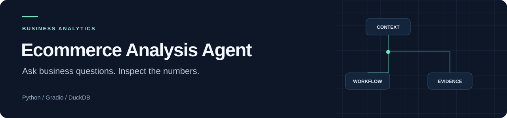
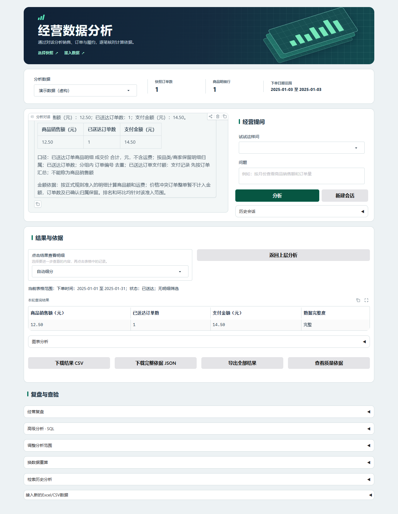
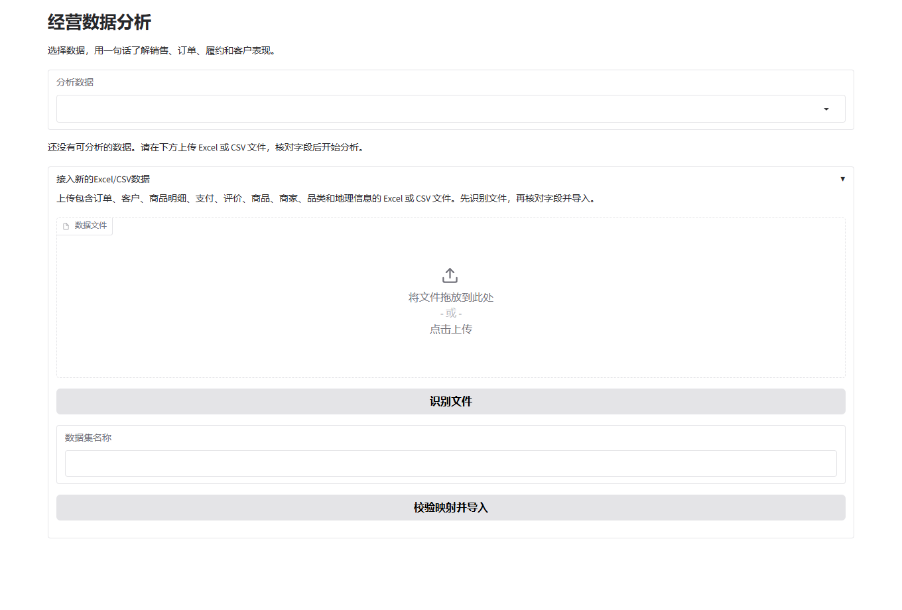
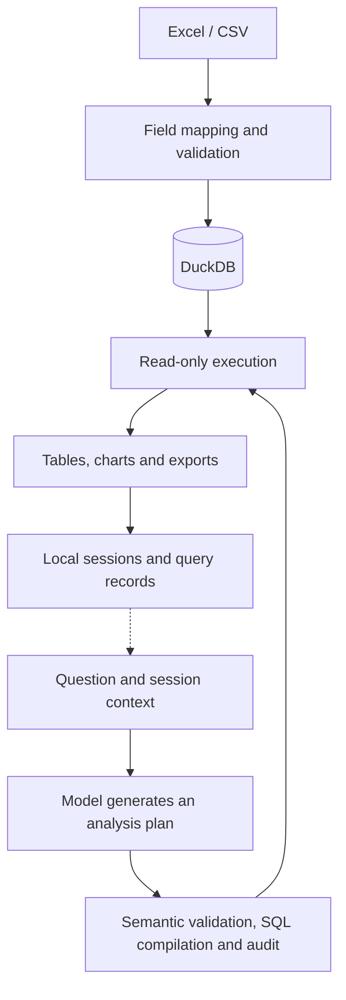

<p align="center"></p>

# Ecommerce Analysis Agent

**English** | [简体中文](README.zh-CN.md)

**Ask business questions. Inspect the numbers.**

[Quick start](#installation-and-startup) · [Features](#features) · [Screenshots](#screenshots) · [Data format](#supported-data-formats) · [Profile](https://github.com/victoryloser)

[](https://github.com/victoryloser/ecommerce-analysis-agent/actions/workflows/ci.yml) · `Python 3.11` · `Gradio` · `DuckDB` · [MIT](LICENSE)

Analyze ecommerce operations through natural-language questions. Explore product sales, order counts, repeat customers, reviews, and delivery performance, with follow-up questions, clarification, chart drilldowns, persistent sessions, and read-only SQL analysis.

## Features

| Feature | What you can do |
|---|---|
| Natural-language queries | Describe metrics, dates, and filters to get tables and charts |
| Joint dimensions | Analyze category × seller or month × category, rank within groups with ties, and drill into the complete combination |
| Follow-up analysis | Refine a question, supply a missing year, or click a group to inspect its details |
| History and exports | Restore local sessions and download the current page or complete query results |
| SQL workspace | Run read-only SQL against source tables or the complete result of a previous analysis |
| Data import | Upload Excel / CSV files that follow the supported ecommerce schema and confirm field mappings |
| Snapshot comparison | Compare a fixed scope or replay the analysis intent; inspect revisions, membership changes, quality transitions, and a complete evidence bundle |

Snapshot comparison is available in the “换数据重算” panel. Select a target snapshot and choose either a fixed scope or intent replay, then compare and download the evidence bundle. Failed comparisons can resume from the last completed stage. Rebuilding built-in samples preserves earlier snapshots.

Try “Rank the top three sellers within each category by product sales, retaining ties” or “Show monthly product sales by category.” Category × seller also supports period comparisons and growth or decline contributions with global and category denominators. Order counts and reviews cannot be summed across overlapping groups. Joint payment allocation and repeat-customer metrics are unsupported; see the [metric definitions (Chinese)](docs/metrics.md).

## Screenshots

The screenshots use temporary, fictional records and scripted model responses to demonstrate the interface and database calculations. Business data files are not included in this repository. The current interface and screenshots use Chinese labels.



<details>
<summary>First launch and data upload</summary>



</details>

## Architecture



The model interprets questions and plans queries. The database calculates amounts, ratios, and rankings. See the [development guide (Chinese)](docs/development.md) for the processing pipeline.

## Requirements

- Python 3.11
- A model service that supports Chat Completions and JSON output

## Installation and startup

Run these commands in the project directory on Windows:

```powershell
python -m venv .venv
.venv/Scripts/python.exe -m pip install -r requirements.lock.txt
.venv/Scripts/python.exe -m pip install --no-deps -e .
Copy-Item .env.example .env
```

Configure the model service in `.env`:

| Variable | Meaning |
|---|---|
| `LLM_BASE_URL` | API base URL, without `/chat/completions` |
| `LLM_API_KEY` | API key |
| `LLM_MODEL` | Model identifier |
| `LLM_TIMEOUT_SECONDS` | Request timeout; defaults to 60 seconds |

Start the application:

```powershell
$env:PYTHONUTF8='1'
.venv/Scripts/python.exe -m app.ui
```

On Linux or macOS:

```bash
python3.11 -m venv .venv
.venv/bin/python -m pip install -r requirements.lock.txt
.venv/bin/python -m pip install --no-deps -e .
cp .env.example .env
# Fill in the model settings in .env before asking natural-language questions.
PYTHONUTF8=1 .venv/bin/python -m app.ui
```

Open http://127.0.0.1:7860. On first launch, expand the data import section (`接入新的Excel/CSV数据`), upload your files, select **Identify files** (`识别文件`), confirm the field mappings, and import the dataset. Importing files and executing manually written SQL do not call the model. Natural-language analysis and SQL draft generation require valid model settings.

Business data, sample datasets, databases, and conversation history are not distributed with the source code. Imported files, databases, and sessions are stored locally in `data/`; query records and exports are stored in `runs/`. These directories are excluded from Git.

## Supported data formats

| Format | Requirements |
|---|---|
| Excel `.xlsx` | Column names in the first row; one business table per worksheet; one or more workbooks |
| CSV `.csv` | UTF-8 or UTF-8 BOM encoding; column names in the first row; one business table per file |

The current version uses an ecommerce data model with nine business tables: orders, customers, order items, payments, reviews, products, sellers, categories, and geolocation. File names, worksheet names, and column names may differ; confirm their mappings during import.

See the [data format specification (Chinese)](docs/data-format.md) for all fields, types, primary keys, and relationships. Files must satisfy both the file format and business schema requirements for the defined metrics to work.

## Usage

Select a dataset and ask a question, for example:

- "What were product sales in April 2025?"
- "How much did that change compared with March?"
- "Show sales by category, then show the seller breakdown for electronics."

If a month has no year, the agent uses the established session context or asks for clarification. Suggested questions state a year when one is needed.

Results include tables, charts, and calculation definitions. Click a group to drill down; return to the previous level to restore its result. Saved sessions can be searched and restored. Starting a new session keeps existing history available.

The SQL workspace supports source-table queries and further analysis of the complete previous result, with editable SQL, generated drafts, and CSV exports. Each imported dataset has its own data snapshot.

The command-line interface uses the same local datasets and sessions:

```powershell
.venv/Scripts/python.exe -m app.cli
```

The CLI selects the first imported dataset by default. Use `--dataset DATASET_ID` to choose another. Import data through the web interface before using the CLI for the first time. On Linux or macOS, use `.venv/bin/python`.

## Metric definitions

By default, product sales use delivered orders, are filtered by purchase time, and exclude freight. Other order statuses, date fields, and periods can be requested explicitly. See the [metric definitions (Chinese)](docs/metrics.md).

The model generates structured analysis plans; the database performs numerical calculations. Custom SQL calculations are presented as exploratory results. Queries are read-only. After changing source files, stop the application and reimport the data.

## Project structure

| Directory | Purpose |
|---|---|
| `app/` | Planning, metric definitions, SQL execution, sessions, and UI |
| `tests/` | Business-logic and workflow tests |
| `scripts/` | Validation, release, and development tools |
| `docs/` | Data schema, architecture, and development documentation |
| `data/` | Local snapshots, imported files, and session database; excluded from Git |
| `runs/` | Local query records and exports; excluded from Git |

## Tests

```powershell
.venv/Scripts/python.exe -m pytest -q
```

Tests generate minimal temporary records to verify first launch, Excel / CSV import, and queries without calling a real model service. Historical sample regressions require locally supplied sample files and are explicitly skipped when those files are unavailable. See the [development guide (Chinese)](docs/development.md) for details.

[GitHub Actions](.github/workflows/ci.yml) runs on pushes and pull requests. It installs dependencies, runs offline tests, and checks source packaging on Ubuntu and Windows with Python 3.11. No model API key is required. Test reports are retained for seven days.

To regenerate the screenshots, follow the [screenshot instructions (Chinese)](docs/development.md#文档截图). The process uses temporary fictional records and does not read local business data.

## License

This project is licensed under the [MIT License](LICENSE). You may use, modify, and redistribute it while retaining the copyright and license notice. Third-party dependencies retain their respective licenses.
