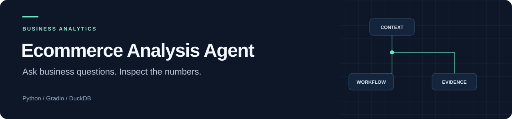
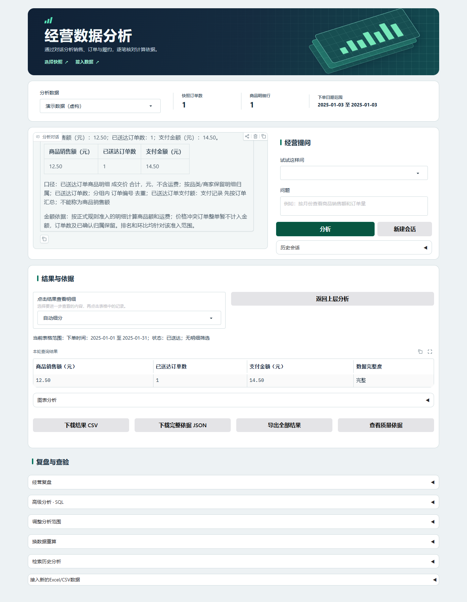
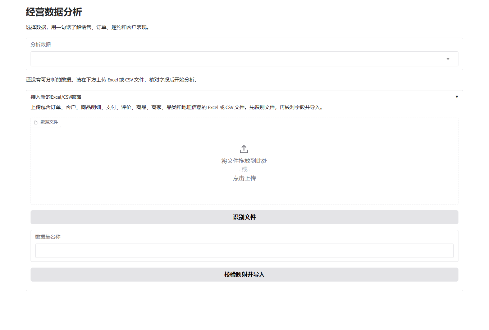
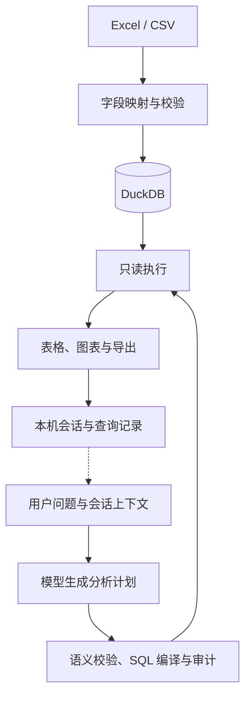

<p align="center"></p>

# 经营数据分析

[English](README.md) | **简体中文**

**从经营问题到可检查的数据结果。**

[快速开始](#安装与启动) · [核心功能](#核心功能) · [界面预览](#界面预览) · [数据格式](#支持的数据格式) · [个人主页](https://github.com/victoryloser)

[](https://github.com/victoryloser/ecommerce-analysis-agent/actions/workflows/ci.yml) · `Python 3.11` · `Gradio` · `DuckDB` · [MIT](LICENSE)

通过自然语言查询经营数据，查看销售额、订单量、复购、评价及履约指标。支持多轮追问、条件澄清、图表下钻、长期会话和只读 SQL 分析。

## 核心功能

| 能力 | 使用方式 |
|---|---|
| 自然语言问数 | 描述要查询的指标、日期和筛选条件，获取表格与图表 |
| 连续分析 | 继续追问、补充年份，或点击分组进一步查看明细 |
| 历史与导出 | 恢复本机会话，下载当前页或完整查询结果 |
| SQL 分析 | 对原始表或完整分析结果执行只读 SQL |
| 数据接入 | 上传符合当前电商表结构的 Excel / CSV，核对字段后导入 |

## 界面预览

截图使用临时生成的虚构记录和固定模型响应，展示界面操作与计算结果。仓库不包含业务数据文件。



<details>
<summary>查看首次启动与数据上传界面</summary>



</details>

## 架构



模型负责理解问题和规划查询，数据库负责金额、比例和排名等数值计算。详细处理链路见 [开发文档](docs/development.md)。

## 环境要求

- Python 3.11
- 支持 Chat Completions 和 JSON 输出的模型服务

## 安装与启动

在项目目录执行：

```powershell
python -m venv .venv
.venv/Scripts/python.exe -m pip install -r requirements.lock.txt
.venv/Scripts/python.exe -m pip install --no-deps -e .
Copy-Item .env.example .env
```

在 .env 中填写模型配置：

| 配置 | 含义 |
|---|---|
| LLM_BASE_URL | 模型接口地址，不包含 /chat/completions |
| LLM_API_KEY | API 密钥 |
| LLM_MODEL | 模型标识 |
| LLM_TIMEOUT_SECONDS | 请求超时，默认 60 秒 |

启动应用：

```powershell
$env:PYTHONUTF8='1'
.venv/Scripts/python.exe -m app.ui
```

浏览器访问 http://127.0.0.1:7860 。首次打开时，在“接入新的Excel/CSV数据”中上传自己的文件，点击“识别文件”，核对字段对应关系后导入。导入文件和执行手写 SQL 不需要调用模型；自然语言分析及生成 SQL 草稿需要填写有效模型配置。

仓库不包含业务数据、示例数据、数据库或历史对话。导入后的文件、数据库和会话保存在本机 `data/`，查询记录及导出结果保存在 `runs/`，均不进入 Git。Linux/macOS 将 `.venv/Scripts/python.exe` 替换为 `.venv/bin/python`。

## 支持的数据格式

| 文件格式 | 要求 |
|---|---|
| Excel `.xlsx` | 首行为字段名，一张工作表对应一张业务表，可上传一个或多个工作簿 |
| CSV `.csv` | UTF-8 或 UTF-8 BOM 编码，首行为字段名，一个文件对应一张业务表 |

当前版本按电商经营数据模型进行分析，需要订单、客户、订单商品明细、支付、评价、商品、商家、品类和地理信息共九张业务表。文件名、工作表名和列名可以不同，在导入页面确认对应关系即可。

完整字段、数据类型、主键及关联要求见 [数据格式说明](docs/data-format.md)。文件符合 Excel/CSV 格式后，还需要符合这些业务表结构，系统才能计算已定义的经营指标。

## 使用

选择数据集后输入问题，例如：

- “2025 年 4 月商品销售额是多少？”
- “比 3 月增长多少？”
- “按品类看销售额，再查看电子产品的商家分布。”

月份缺少年份时，系统根据会话条件继续分析或请求补充。界面中的示例问题直接注明年份。

分析结果包含表格、图表和计算依据。点击分组可下钻，返回上层可恢复之前的结果。历史会话支持检索与恢复；新建会话后原有记录仍可访问。

SQL 工作区可查询原始表或上次完整分析结果，支持手工编辑 SQL、生成草稿及导出 CSV。数据上传支持九张业务表的字段映射与独立数据集导入。

命令行入口：

```powershell
.venv/Scripts/python.exe -m app.cli
```

命令行默认使用已导入的首个数据集，也可以通过 `--dataset 数据集ID` 指定数据集。首次使用时先通过页面导入数据。

## 数据口径

默认商品销售额使用已送达订单及下单时间，不含运费。其他状态、日期字段和范围可在查询中指定。指标定义见 [指标口径](docs/metrics.md)。

模型生成结构化分析计划，数据库执行数值计算。自由 SQL 的自定义计算标记为探索结果。数据库为只读查询；更新源文件后停止应用并重新导入。

## 项目结构

| 目录 | 职责 |
|---|---|
| app/ | 规划、指标定义、SQL 执行、会话和界面 |
| tests/ | 业务与流程测试 |
| scripts/ | 检查与开发工具 |
| docs/ | 架构和开发说明 |
| data/ | 本地数据快照、上传数据和会话库 |
| runs/ | 查询证据和运行日志 |

## 测试

```powershell
.venv/Scripts/python.exe -m pytest -q
```

测试包含临时生成的最小业务记录，用于验证无数据启动、Excel/CSV 导入及查询，不调用真实模型服务。历史样例回归需要本机另行提供样例文件，缺少文件时会明确跳过；说明见 [开发文档](docs/development.md)。

[GitHub Actions](.github/workflows/ci.yml) 在推送代码或提交 Pull Request 时，使用 Python 3.11 分别在 Ubuntu 和 Windows 上安装依赖、运行离线测试并检查源码打包。无需配置模型 API 密钥，测试报告保留七天。

界面截图可按 [开发文档](docs/development.md#文档截图) 中的命令重新生成；该过程使用临时虚构记录，不读取本机业务数据。

## 许可证

项目采用 [MIT License](LICENSE)，允许使用、修改和分发，分发时需保留版权和许可声明。第三方依赖遵循各自的许可证。
