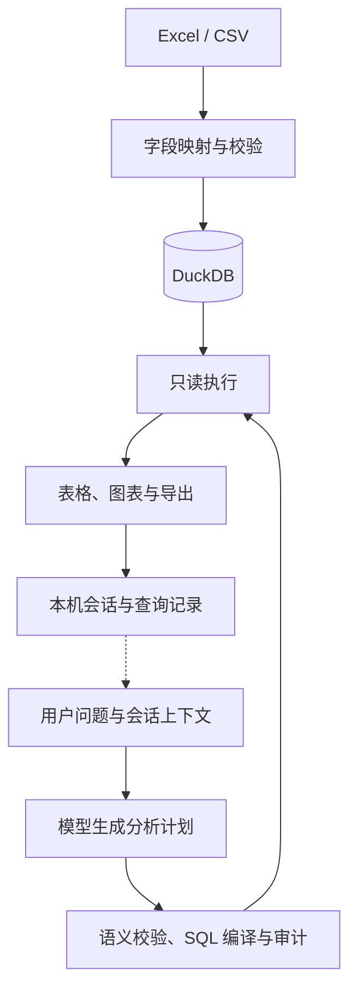

<p align="center"></p>

# 经营数据分析

[English](README.md) | **简体中文**

**从经营问题到可检查的数据结果。**

[快速开始](#安装与启动) · [核心功能](#核心功能) · [界面预览](#界面预览) · [数据格式](#支持的数据格式) · [个人主页](https://github.com/victoryloser)

[](https://github.com/victoryloser/ecommerce-analysis-agent/actions/workflows/ci.yml) · `Python 3.11` · `Gradio` · `DuckDB` · [MIT](LICENSE)

通过自然语言查询经营数据，查看销售额、订单量、复购、评价及履约指标。支持多轮追问、条件澄清、图表下钻、长期会话和只读 SQL 分析。

## 核心功能

| 能力 | 使用方式 |
|---|---|
| 自然语言问数 | 描述要查询的指标、日期和筛选条件，获取表格与图表 |
| 联合维度 | 按品类 × 商家、月份 × 品类、品类 × 客户省份分析，组内排名保留并列，组合下钻继承完整条件 |
| 连续分析 | 继续追问、补充年份，或点击分组进一步查看明细 |
| 历史与导出 | 恢复本机会话，下载当前页或完整查询结果 |
| SQL 分析 | 对原始表或完整分析结果执行只读 SQL |
| 数据接入 | 上传符合当前电商表结构的 Excel / CSV，核对字段后导入 |
| 版本比较 | 固定范围或按原意图重算，查看金额修订、范围进出、质量变化及完整证据包 |
| 经营复盘 | 保存两期总览和品类贡献，比较同一范围的两个版本，并查看受影响订单与原始记录 |

版本比较位于“换数据重算”：选择目标快照及“固定范围”或“按原意图”模式，执行比较后可下载证据包。失败后可从已完成阶段继续；内置样例重建保留旧快照。

完成两期总体比较后，展开“经营复盘”，点击“从当前结果生成复盘”。可以查品类贡献和本期商家，或选择另一套快照核对差额变化。复盘保存在当前会话，恢复该会话后可从“已保存的复盘”打开。检索历史分析后点击命中行可查看对应回合的依据。

联合分析示例：“全期每个品类分别按商品销售额列出前三商家，保留并列”“按月份和品类查看全期商品销售额趋势”。品类 × 商家还支持期间比较、增长或下降贡献，以及品类内贡献率。联合订单数与评价不可跨组直接相加，支付分摊及复购不支持联合分组，详见 [指标口径](docs/metrics.md)。

## 界面预览

截图使用临时生成的虚构记录和固定模型响应，展示界面操作与计算结果。仓库不包含业务数据文件。


<details>
<summary>查看首次启动与数据上传界面</summary>


</details>

## 架构



模型负责理解问题和规划查询，数据库负责金额、比例和排名等数值计算。详细处理链路见 [开发文档](docs/development.md)。

## 环境要求

- Python 3.11
- 支持 Chat Completions 和 JSON 输出的模型服务

## 安装与启动

在项目目录执行：

```powershell
python -m venv .venv
.venv/Scripts/python.exe -m pip install -r requirements.lock.txt
.venv/Scripts/python.exe -m pip install --no-deps -e .
Copy-Item .env.example .env
```

在 .env 中填写模型配置：

| 配置 | 含义 |
|---|---|
| LLM_BASE_URL | 模型接口地址，不包含 /chat/completions |
| LLM_API_KEY | API 密钥 |
| LLM_MODEL | 模型标识 |
| LLM_TIMEOUT_SECONDS | 请求超时，默认 60 秒 |

启动应用：

```powershell
$env:PYTHONUTF8='1'
.venv/Scripts/python.exe -m app.ui
```

浏览器访问 http://127.0.0.1:7860 。首次打开时，在“接入新的Excel/CSV数据”中上传自己的文件，点击“识别文件”，核对字段对应关系后导入。导入文件和执行手写 SQL 不需要调用模型；自然语言分析及生成 SQL 草稿需要填写有效模型配置。

**后续换版**　在已有会话中发送“数据更新了”（命令行也支持 `/sync`）。首次检查会创建并显示该数据集的交付目录，默认位于 `data/incoming/<初始快照ID>/`。如需使用共享盘，可在服务端的环境变量或 `.env` 中设置 `DATA_DELIVERY_DIR` 为共享根目录。数据团队在对应子目录放好一套完整的新版 CSV 或 Excel 后，业务人员再次发送同一句话，助手会读取文件、沿用字段映射和金额规则、切换快照，并按当前分析意图重算。后续版本继续用同一目录。请在整套导出写完后发起同步。当前会话已经使用相同文件时，助手会直接报告版本一致；表结构变化可在上传界面重新核对映射。

仓库不包含业务数据、示例数据、数据库或历史对话。导入后的文件、数据库和会话保存在本机 `data/`，查询记录及导出结果保存在 `runs/`，均不进入 Git。Linux/macOS 将 `.venv/Scripts/python.exe` 替换为 `.venv/bin/python`。

## 支持的数据格式

| 文件格式 | 要求 |
|---|---|
| Excel `.xlsx` | 首行为字段名，一张工作表对应一张业务表，可上传一个或多个工作簿 |
| CSV `.csv` | UTF-8 或 UTF-8 BOM 编码，首行为字段名，一个文件对应一张业务表 |

导入时可选择完整九表或“订单和商品明细”。轻量模板用两张表计算订单数和商品额，可按实际来源开启运费、品类、商家、支付及评价分析。首次导入请核对状态、币种和行金额定义。两种模板均支持中文列名映射、不可变快照及换版重算。

完整字段、数据类型、主键及关联要求见 [数据格式说明](docs/data-format.md)。文件符合 Excel/CSV 格式后，还需要符合这些业务表结构，系统才能计算已定义的经营指标。

## 团队试用

一个客户对应一个服务进程和专用实例目录。先按“安装与启动”安装依赖。在 PowerShell 中为新实例执行以下命令。实例路径由部署者选定。首次复制示例配置后，将客户自己的模型配置填写到该目录的 `.env`。

```powershell
$env:ANALYSIS_INSTANCE_DIR = 'D:\analysis-instances\pilot'
New-Item -ItemType Directory -Force -Path $env:ANALYSIS_INSTANCE_DIR | Out-Null
Copy-Item .env.example (Join-Path $env:ANALYSIS_INSTANCE_DIR '.env') -NoClobber
.venv/Scripts/python.exe -m app.team_access admin --role admin
.venv/Scripts/python.exe -m app.ui --port 7860
```

在浏览器打开 `http://127.0.0.1:7860`，登录后展开“接入数据”，识别并确认映射。轻量模板可在导入前点击“核对可用指标”，查看当前口径能回答的问题和缺少的来源。导入后，分析员选择快照即可看到对应的示例问题。导入结果显示快照 ID。口令由终端交互输入。可在另一终端设置相同实例目录，使用实际 ID 替换以下示例的 `upload_xxx`。

```powershell
.venv/Scripts/python.exe -m app.team_access ops --role analyst --feed upload_xxx
.venv/Scripts/python.exe -m app.team_access finance --role analyst --dataset upload_xxx --grant details --grant export
.venv/Scripts/python.exe -m app.team_access manager --role reader --dataset upload_xxx
.venv/Scripts/python.exe -m app.team_access finance --access-only --role analyst --dataset upload_xxx --grant details
```

- 管理员导入数据及认领本机旧会话。分析员可问答、搜索自己的历史、对比获授权的两个快照、分享当前已核验汇总。读者登录后只可打开指定给自己的汇总。明细、SQL 和完整导出各有独立授权。查询原始表的 SQL 需要同时具备 SQL 和明细权限。
- `--dataset` 只授权该快照，`--feed` 授权同一交付源的当前及后续版本，两者均可重复指定。授权更新在后续请求及旧链接下载时生效。私人历史按账号、角色和明细及 SQL 授权分开保存。新增快照授权后，原快照中仍获授权的历史可继续使用。
- 团队成员使用网页入口。对外访问在反向代理终止 HTTPS，后端只监听回环地址。使用企业登录时，由已认证网关重写 `X-Analysis-User` 并注入实例配置的随机 `X-Analysis-Proxy` 凭据，值与 `TEAM_PROXY_SECRET` 一致。网关应清除客户端传入的这两个请求头。账号和授权由实例管理员配置。
- 每个实例从自己的 `.env` 和进程环境读取模型配置。`TEAM_MODEL_FIELDS` 默认允许当前问题、命中的实体和分析条件，可选 `history` 或 `preview:sales,preview:order_count`。当前问题按原文发送。移除 `question` 可关闭模型问答和 SQL 草稿，手工 SQL 仍可在授权范围执行。
- 分享报告默认可见 90 天，下载链接默认有效 7 天，操作日志默认保留 30 天，天数可在实例配置中设置。运维记录位于 `data/team.sqlite3` 的 `operations` 表，仅记录路由、状态和耗时。查询证据及业务事件在实例的 `runs/`，源数据和私有会话在 `data/`，由客户按档案期限备份与清理。链接到期只移除访问记录。

## 使用

选择数据集后输入问题，例如：

- “2025 年 4 月商品销售额是多少？”
- “比 3 月增长多少？”
- “按品类看销售额，再查看电子产品的商家分布。”

月份缺少年份时，系统根据会话条件继续分析或请求补充。界面中的示例问题直接注明年份。

分析结果包含表格、图表和计算依据。点击分组可下钻，返回上层可恢复之前的结果。历史会话支持检索与恢复；新建会话后原有记录仍可访问。

SQL 工作区可查询当前模板映射的原始表或上次完整分析结果，支持手工编辑 SQL、生成草稿及导出 CSV。

命令行入口：

```powershell
.venv/Scripts/python.exe -m app.cli
```

命令行默认使用已导入的首个数据集，也可以通过 `--dataset 数据集ID` 指定数据集。首次使用时先通过页面导入数据。

## 数据口径

默认商品销售额使用已送达订单及下单时间，不含运费。其他状态、日期字段和范围可在查询中指定。指标定义见 [指标口径](docs/metrics.md)。

模型生成结构化分析计划，数据库执行数值计算。自由 SQL 的自定义计算标记为探索结果。快照以只读方式查询，完整新版交付后可在当前会话输入“数据更新了”重算。

## 项目结构

| 目录 | 职责 |
|---|---|
| app/ | 规划、指标定义、SQL 执行、会话和界面 |
| tests/ | 业务与流程测试 |
| scripts/ | 检查与开发工具 |
| docs/ | 架构和开发说明 |
| data/ | 本地数据快照、上传数据和会话库 |
| runs/ | 查询证据和运行日志 |

## 测试

```powershell
.venv/Scripts/python.exe -m pytest -q
```

测试包含临时生成的最小业务记录，用于验证无数据启动、Excel/CSV 导入及查询，不调用真实模型服务。历史样例回归需要本机另行提供样例文件，缺少文件时会明确跳过；说明见 [开发文档](docs/development.md)。

[GitHub Actions](.github/workflows/ci.yml) 在推送代码或提交 Pull Request 时，使用 Python 3.11 分别在 Ubuntu 和 Windows 上安装依赖、运行离线测试并检查源码打包。无需配置模型 API 密钥，测试报告保留七天。

界面截图可按 [开发文档](docs/development.md#文档截图) 中的命令重新生成；该过程使用临时虚构记录，不读取本机业务数据。

## 许可证

项目采用 [MIT License](LICENSE)，允许使用、修改和分发，分发时需保留版权和许可声明。第三方依赖遵循各自的许可证。
